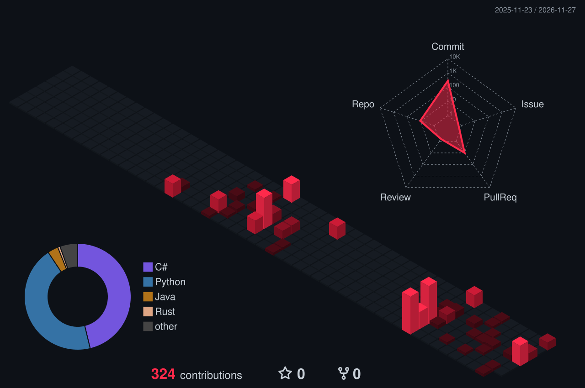

<!-- CUSTOM SVG HEADER -->

  

<!-- QUICK LINKS -->

  
  

---

### ▸ Engineering Focus

I'm an **Applied AI** student at **UrFU (IRIT-RTF)** building at the intersection of **machine learning** and **systems programming**. I work primarily in **Python** and **Rust** (currently expanding into **Java**), contribute to large open-source codebases, and enjoy going down the stack - from LLM agents to custom hardware drivers.

| Domain | What I Build |
| :--- | :--- |
| **AI & Machine Learning** | LLM-powered agents, applied ML pipelines, computer vision, AI backends |
| **Systems & Open Source** | Rust tooling, plugin architectures, low-level streaming drivers |

---

### ▸ Selected Work

| Project | Highlights | Stack |
| :--- | :--- | :--- |
| **[EffectCraft](https://github.com/storytold/effectcraft)** *(9.5k+ ★)* | Contributed a complete, production-ready plugin installation library to a pure-Rust motion graphics & compositing engine | `Rust` |
| **[Rerun](https://github.com/rerun-io/rerun)** *(11.9k+ ★)* | Open-source contributions to a multimodal robotics data visualization & streaming engine | `Rust` |
| **[hitcam](https://github.com/iseemhlyfta/hitcam)** | Custom camera & video streaming tooling | `C#` |
| **Sber AI Tools** | Built an AI bot for commercial real estate search and a global speaker search & collaboration platform | `Python` `LLMs` `AI Agents` |
| **Phone-to-PC Camera Driver** | Wrote a working low-level driver from scratch to transmit a live video stream from a smartphone camera to a PC | `Systems` `Drivers` |

---

### ▸ Tech Stack

  
  
  
  

  
  
  
  
  

---

### ▸ 3D Contribution City

  

  

